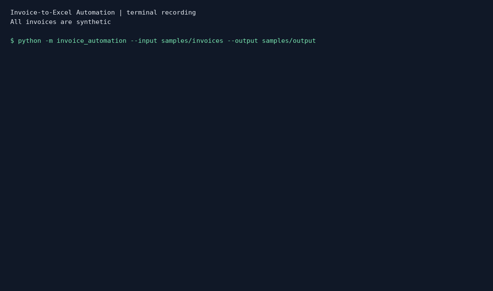
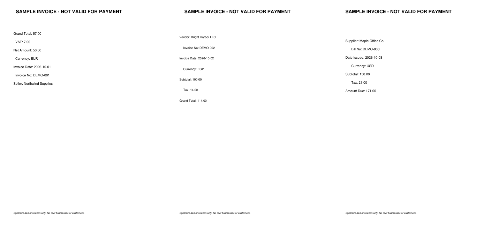

# Invoice-to-Excel Automation

A reproducible **Python 3.12 portfolio project** that turns a folder of **text-based PDF invoices** into a validated Excel workbook and CSV files. Built for a small-business workflow: extract invoice data, route uncertain records for human review, flag duplicates, and summarize amounts **by currency** (no misleading cross-currency sum).

## Quick start

```bash
python -m venv .venv
# macOS/Linux: source .venv/bin/activate
# Windows PowerShell: .venv\Scripts\Activate.ps1
pip install -r requirements.txt
python generate_samples.py
python -m invoice_automation --input samples/invoices --output output
python -m pytest -q
```

Python 3.12 recommended. The bundled `samples/invoices/` already contains 13 fabricated examples, so generation is optional.

## Recorded demo



[Terminal recording](docs/demo.cast) captures actual command output. This is a terminal demo, not a desktop screen capture. Regenerate it with `python docs/record_demo.py` (requires Pillow and a DejaVu Sans Mono font).



## Results

- `output/invoices.csv` — records that passed all checks
- `output/processing_errors.csv` — rejected/uncertain records with explicit reasons
- `output/summary_by_currency.csv` — counts and totals separated by currency
- `output/processing_summary.json` — processed, accepted and review counts plus currency totals
- `output/invoice_report.xlsx` — styled workbook with **Invoices**, **Needs Review**, and **Currency Summary** tabs

Example output is committed under `samples/output/`. All invoice values are fictional.

## Checks and processing rules

1. Extract text with PyMuPDF, using rule-based **labeled fields** (`Vendor`, `Invoice No`, `Invoice Date`, `Currency`, `Subtotal`, `Tax`, `Grand Total`).
2. Require and normalize all seven fields; do not fabricate missing values.
3. Normalize invoice dates to ISO (`YYYY-MM-DD`), money to `Decimal`, and supported currency codes to uppercase (`USD`, `EUR`, `GBP`, `EGP`).
4. Check that subtotal + tax equals total (within 0.01); reject negative monetary values.
5. De-duplicate successful records by normalized **vendor + invoice ID**. Duplicate files go to the review sheet.
6. If extraction is ambiguous or fails, send the invoice to review instead of treating it as correct.

### Demonstration outcomes

The 13 synthetic invoices deliberately include a missing currency, mismatched total, duplicate ID/vendor, and invalid date. The pipeline accepts 9 valid invoices and places 4 in the review queue.

Accepted sample totals: EUR 684.00, EGP 855.00, USD 1,026.00. Values are never added across currencies.

Example before: `Seller: Northwind Supplies`, `Invoice No: DEMO-001`, `Grand Total: 57.00` in [a sample PDF](samples/invoices/invoice_01.pdf).

Example after: `Northwind Supplies,DEMO-001,2026-10-01,EUR,50.00,7.00,57.00` in [the resulting CSV](samples/output/invoices.csv). Download [the example workbook](samples/output/invoice_report.xlsx) to inspect all three tabs.

## MVP milestones and acceptance tests

1. Generate 13 synthetic PDFs with varied labels, order, fonts and spacing.
2. Extract complete labeled values; normalize dates, vendor whitespace, IDs and amounts.
3. Reject missing/ambiguous fields, invalid dates/IDs/currencies, malformed or negative amounts, symbol mismatches and totals that fail reconciliation.
4. Accept one record per normalized vendor and invoice ID. The first valid file in filename order wins; later duplicates go to review, including differing amounts. Resolve conflicts manually.
5. Export workbook, CSV reports and processing counts; tests reopen the workbook to verify numeric cells and expected totals.
6. Run 25 tests and the sample pipeline on Python 3.12 in GitHub Actions.

## Folder structure

```
invoice_automation/       # extraction, batch processing, CLI
samples/invoices/         # 13 synthetic input PDFs
samples/output/           # generated example output files
tests/                    # pytest validation and duplicate tests
generate_samples.py       # generate synthetic PDFs
requirements.txt
LICENSE
```

## Limitations

- **Text-based PDFs only:** scanned/image PDFs require a separate OCR pipeline, intentionally not included.
- This is a deliberately narrow, rule-based MVP. It recognizes documented label patterns, not arbitrary invoice layouts or foreign-language invoices.
- No line-item extraction, multi-invoice PDFs, partial credits, complex tax structures, exchange rates, or accounting-system integration.
- Ambiguous values are sent for review. A *plausible but incorrectly labeled* value can still evade rule-based checks; use human review before financial decisions.
- Dates use ISO or documented day-first numeric conventions, including ambiguous dates such as 01/02/2026 meaning 1 February. US month-first dates require different rules.
- One invoice per PDF. Multiple differing labeled values cause review; repeated identical labels cannot reliably distinguish two invoices.
- Input is one local folder (non-recursive), including `.pdf` and `.PDF`. There is no web upload interface.
- Money uses dot decimals and optional comma thousands separators, maximum two decimal places. European decimal commas and credit notes are unsupported. CSV values retain decimal precision; Excel receives numeric cells.
- PyMuPDF has AGPL/commercial licensing requirements; review its license before distributing a proprietary application. The MIT license applies to this project's own code.
- PDFs are processed locally. Do not upload confidential customer invoices to public GitHub.

## Tests

Run `python -m pytest -q` for valid extraction, missing vendor, impossible dates, inconsistent totals, blank/scanned-like PDFs, duplicate invoices, and an empty input folder.

## Learning walkthrough

1. Run `python generate_samples.py` to recreate the input PDFs.
2. Run `python -m pytest -q` to check extraction, validation, batch handling and workbook exports.
3. Run `python -m invoice_automation --input samples/invoices --output output`.
4. Open `output/invoice_report.xlsx` and investigate `Needs Review`.

For an optional desktop recording, open the `samples/invoices` folder; open two PDFs showing distinct layouts; run the one-line CLI; open the Excel report's three tabs; highlight rejected invoices and summary totals; run `python -m pytest -q`. Record a 60–90 second screen capture yourself and link the video here when ready.

## License

MIT. All demo invoice content is synthetic.
