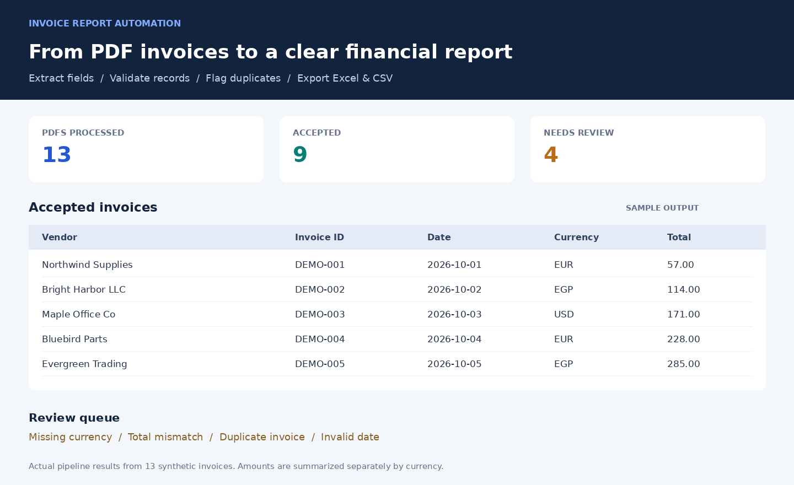

# Invoice Report Automation

Turn a folder of PDF invoices into a validated Excel workbook and CSV reports.

**Python 3.12 · PyMuPDF · pandas · openpyxl · pytest**



[Download sample workbook](samples/output/invoice_report.xlsx) · [View extracted data](samples/output/invoices.csv) · [Inspect review queue](samples/output/processing_errors.csv)

## What it does

Extracts vendor, invoice ID, date, currency, subtotal, tax and total from text-based PDFs. Validates the extracted fields, flags duplicate invoices and routes uncertain records for review. Missing data stays missing.

- **Consistent reports:** normalized dates, identifiers and decimal amounts.
- **Traceable issues:** every rejected record includes its source filename and reason.
- **Currency-aware summaries:** totals remain separate for EUR, USD, GBP and EGP.
- **Local processing:** PDF extraction runs on your machine.

## Try it

```bash
git clone https://github.com/Marr-star/invoice-report-automation..git
cd invoice-report-automation.
python -m venv .venv
```

Activate the environment:

```bash
# macOS / Linux
source .venv/bin/activate

# Windows PowerShell
.venv\Scripts\Activate.ps1
```

Install dependencies and process the included samples:

```bash
python -m pip install -r requirements.txt
python -m invoice_automation --input samples/invoices --output output
```

Open `output/invoice_report.xlsx`. The workbook contains **Invoices**, **Needs Review** and **Currency Summary** sheets.

## Sample invoices

Thirteen fictional invoices use three visual templates, varied field labels and deliberate validation failures.


| Sample result | Count |
| --- | ---: |
| PDFs processed | 13 |
| Accepted invoices | 9 |
| Invoices requiring review | 4 |

The review queue demonstrates a missing currency, a total mismatch, a duplicate invoice and an invalid date.

## Exported files

| File | Contents |
| --- | --- |
| `invoice_report.xlsx` | Accepted records, review queue and currency totals |
| `invoices.csv` | Validated, deduplicated records |
| `processing_errors.csv` | Rejected records with explicit reasons |
| `summary_by_currency.csv` | Accepted invoice counts and totals by currency |
| `processing_summary.json` | Processing counts and currency totals |

## Validation rules

All seven invoice fields are required. Dates must be valid, invoice IDs must match supported characters, currency codes must be supported and amounts must be nonnegative with no more than two decimal places. Subtotal plus tax must equal the total within 0.01.

Conflicting labels and currency symbols trigger review. Duplicates are matched by normalized vendor and invoice ID. The first valid file in filename order is accepted; later duplicates require review, including those with different amounts. Text exported to spreadsheets is escaped against formula injection.

## Tests and development

```bash
python -m pytest -q
python generate_samples.py
```

The 25 tests cover extraction, invalid and missing values, duplicates, multiple PDF files, corrupt PDFs, scanned-like inputs, spreadsheet formula injection and exported workbook values. GitHub Actions runs the tests and sample pipeline on Python 3.12.

```text
invoice_automation/    Extraction, validation, reporting and CLI
samples/invoices/     Synthetic PDF inputs
samples/output/       Example Excel and CSV reports
tests/                Unit and integration tests
docs/                 Visual previews and terminal demo
```

<details>
<summary>Terminal demo and preview generation</summary>


[Download the terminal recording](docs/demo.cast). This recording shows actual CLI execution. The report image above is a static visualization of exported sample data, not a web interface.

To regenerate the visual assets, install Pillow and provide DejaVu Sans fonts, then run:

```bash
python docs/build_previews.py
python docs/record_demo.py
```

</details>

## Supported scope

- Text-based PDFs with supported English field labels. One invoice per file.
- A single local input folder, including `.pdf` and `.PDF` files. No web upload interface.
- ISO or day-first numeric dates. `01/02/2026` means 1 February.
- Dot-decimal amounts with optional comma thousands separators.

Scanned PDFs need OCR and are routed to review. Arbitrary layouts, European decimal commas, credit notes, complex tax structures, line-item extraction and accounting integrations are outside this version. Repeated identical labels cannot reliably distinguish multiple invoices within one PDF. Rule-based extraction still needs human verification before accounting use.

## License

Project code: [MIT](LICENSE). Sample invoice data is fictional. PyMuPDF is separately licensed under AGPL or a commercial license; review its terms for proprietary distribution.
